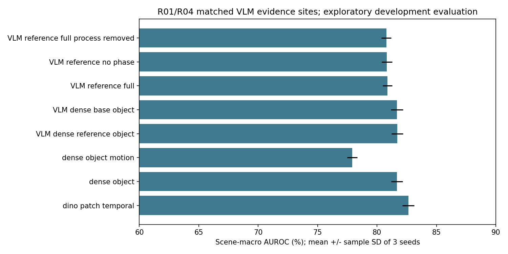

# IPAD VLM Process AD — 정상 영상 기반 산업 이상 탐지 고도화

2026-10-06 실험 기록. 이 저장소는 기존 [ipad-normal-video-ad](https://github.com/b-jongwon/ipad-normal-video-ad)와 분리한 **새 공개 저장소**입니다. 기존 실험을 지우거나, 실패한 방법을 숨기거나, 새 결과를 기존 v3의 결과로 바꾸지 않았습니다.

목표는 **정상 산업 영상으로 기준을 학습하고, 제품 외관·위치·움직임·관측 가능한 공정 순서가 기준에서 벗어나는 구간에 높은 점수를 주는 것**입니다. 영상은 IPAD에서 제공하는 프레임으로 처리합니다. 이상 데이터의 정답은 평가에만 사용합니다.

## 1. 먼저 읽을 결론

이번에는 정상 학습 자료 확대, CLIP/DINOv2 비교, 패치 정상 공간, 정상 프로토타입, 재구성·시계열 예측, 실제 객체 crop의 DINOv2 재추출, VLM의 직접 상태 추정 결과 재사용, 보수적인 phase routing, 관측 간격별 공정 전이, 인과적 점수 평활화, 반복 실험과 평가를 수행했습니다.

| 비교 경로 | 같은 VLM 관측 지점에서 평균 AUROC | 3 seed 표준편차 |
|---|---:|---:|
| 기존 직접 VLM mentor Full | 65.06% | 기존 단일 fitting |
| 개선된 mentor형 Full: phase + object + process + learned visual | 80.88% | 0.40%p |
| 개선된 객체·시각·시간 경로 + 실제 VLM process | **81.70%** | 0.48%p |
| 위 객체 경로에서 VLM process만 제거 | 81.67% | 0.49%p |
| DINOv2 패치 + 재구성 + 예측 + 평활화, 직접 VLM process 없음 | **82.63%** | 0.50%p |
| 객체 경로에 geometry/motion도 추가 | 77.90% | 0.43%p |

숫자는 R01/R04 각각의 frame AUROC를 평균하고, 다시 seed 0/1/2를 평균한 값입니다. 최고 seed만 고른 값이 아닙니다. ± 값은 **3 seed의 표본 표준편차**이며 신뢰구간이 아닙니다.

**고도화된 경로의 성능은 개선되었지만, 개선이 VLM 때문이라는 주장은 아직 입증되지 않았습니다.** 같은 객체 경로에서 VLM process를 넣은 변화는 평균 약 +0.024%p에 불과합니다. 객체 추가도 R04에는 도움이 되었으나 R01에는 손해였습니다. motion 추가 역시 모든 장면에 도움이 되지 않았습니다.

또한 정상 CAL의 q99 임계값을 적용하면 정상 테스트 프레임의 오탐률이 높습니다. AUROC 80%대라는 사실을 “현장에서 정상/불량을 80% 정확도로 분류한다”로 해석하면 안 됩니다. 이 저장소는 연구 개발 결과이지, 즉시 배포 가능한 범용 공장 검사 제품은 아닙니다.



## 2. 무엇이 새로 실행되었나

| 항목 | 이번 실행 |
|---|---|
| 장면 | IPAD R01/R04, 2개 장면 |
| 정상/테스트 시각 관측 간격 | 모든 split에서 원본 8프레임 간격 |
| 정상 학습 | FIT: R01 672, R04 822 관측 |
| 조기 종료용 정상 검증 | TUNE: R01 117, R04 158 관측 |
| 점수·임계값 보정용 정상 검증 | CAL: R01 202, R04 248 관측 |
| 전체 촘촘한 테스트 | R01 466, R04 1,027 관측 |
| 기존 VLM과 정확히 같은 테스트 관측 | R01 125, R04 264 관측 |
| 실제 gradient 학습 | 24개 head: 2 장면 × 2 encoder × 2 head × 3 seed |
| 학습 최대치 | 최대 40 epoch, 정상 TUNE loss 조기 종료 patience 6 |
| 실제 수행 epoch | 모델별 22~40 |
| 선택된 checkpoint epoch | 모델별 16~40 |
| 새 객체 DINOv2 특징 | 실제 GDINO bbox crop **6,490개** 재추출 |
| 새로운 유료 VLM 요청 | **0건** — 승인 예산을 위해 기존 응답 재사용 |
| API VLM/CLIP/DINOv2/GDINO 가중치 업데이트 | 0회; 모두 사전학습 모델 그대로 |
| 결과표 | 428 scene/method/support 행. 428개 독립 모델이라는 뜻 아님 |
| 검증 | 저장 모델 24개 score replay 일치, offline 테스트 27개 통과 |
| 추가 통계 | recording 단위 bootstrap 500회 × 4 비교 |

엄격한 프레임/정답 길이 일치 정책에 맞는 테스트 녹화를 유지합니다. 정답 값이 어려워 보이는 영상을 빼거나, 정상 프레임만 골라 테스트하지 않습니다. 길이가 불일치하는 녹화는 임의 보간으로 맞추지 않습니다.

## 3. 쉽게 설명하는 전체 구조

1. 정상 영상에서 프레임을 뽑습니다. 영상 중 일부 프레임을 사용해도 영상 학습이라는 목적은 유지됩니다.
2. 사전학습 모델은 프레임과 객체를 숫자 벡터로 바꿉니다. 이 숫자가 feature입니다.
3. 정상 feature가 평소 어떤 범위에 모이는지 PCA와 프로토타입으로 저장합니다.
4. 작은 오토인코더는 정상 feature를 복원하는 방법을 학습합니다.
5. 작은 GRU는 같은 녹화의 **과거 8개 feature만** 보고 현재 feature를 예측하는 방법을 학습합니다.
6. 원래 GPT가 정상 영상에서 만든 객체·공정 단계 설명을 사용합니다. 이전 직접 VLM 실행은 실제 전체 이미지와 객체 crop을 보고 단계·객체 상태·일관성 위반을 추정했습니다.
7. 이번 실행은 그 **실제 VLM 응답을 동일한 원본 관측에 다시 연결**합니다. 응답이 없는 중간 프레임에는 GPT가 새로 판단했다고 적지 않습니다.
8. 외관이 정상 공간에서 벗어난 정도, 복원/예측 실패 정도, 실제 VLM이 관측한 공정 위반을 조합합니다.
9. 현재와 과거 점수만 사용하는 EWMA로 잡음을 줄입니다. 최종 임계값은 별도 정상 CAL에서 정합니다.
10. 마지막에만 이상 정답과 비교해서 AUROC, AP, 오탐, 미탐, 이벤트 지표를 계산합니다.

한 개 점수로 모든 문제를 해결하려는 구조가 아닙니다. 어떤 모듈이 도움 되는지를 확인하려고 각 모듈을 넣고 빼는 ablation을 함께 수행합니다.

## 4. 데이터 분할과 누수 방지

`FIT / TUNE / CAL / TEST`는 역할이 다릅니다.

| split | 데이터 | 역할 | 해서는 안 되는 일 |
|---|---|---|---|
| FIT | 정상만 | gradient 학습, 평균/표준편차, PCA, 프로토타입, normal ROI |
| TUNE | 다른 정상 녹화 | epoch 선택과 early stopping | 테스트 AUROC가 높은 epoch 선택 |
| CAL | 또 다른 정상 녹화 | 점수 단위 보정, 정상 q99 임계값 | 이상 정답으로 배포 임계값 최적화 |
| TEST | 정상+이상 | 성능 평가 | feature 모델이나 phase 기준 학습에 정답 사용 |

원래 정상 train 녹화에서 일부 녹화를 TUNE으로 떼어냅니다. 이전 GPT가 정상 기준 작성에 사용한 녹화는 FIT에 남도록 보호합니다. 원래 val 녹화는 CAL로 사용합니다. 정상 split끼리 녹화 ID가 겹치지 않는지 코드에서 검증합니다.

다만 이 프로젝트에서는 같은 테스트를 이전 실험에서 이미 확인했습니다. 따라서 이번 TEST를 한 번도 보지 않은 독립 최종 holdout이라고 부르지 않습니다. 학습에 테스트 라벨을 넣지 않았다는 사실과, 여러 실험 결과를 보고 개발 방향을 정했다는 사실은 별개입니다.

새 공장·카메라·제품으로의 일반화를 주장하려면 새 환경을 통째로 holdout하고 같은 절차를 고정해 다시 평가해야 합니다.

## 5. 멘토 제안 1~13단계는 어디까지 했나

아래는 **기존 직접 mentor 실행**과 **이번 refinement 실행**을 구분한 표입니다. 한 ablation에 모든 모듈을 무조건 넣은 것은 아닙니다.

| 단계 | 실제 구현/실행 | 제한·아직 입증하지 못한 것 |
|---|---|---|
| 1 Normal videos | FIT 정상 관측 확대. DAE/GRU와 정상 기준 fitting | 모든 16장면의 이번 refinement는 미수행 |
| 2 VLM/LLM | 이전 실제 GPT의 정상 객체 vocabulary/process grammar 재사용 | 새 grammar 생성/사람 정답 검증은 이번에 하지 않음 |
| 3 GroundingDINO + tracking | 실제 검출·class별 ByteTrack 캐시 사용 | track ID는 원래 stride4에서 생성, 이번에는 stride8 선택. 검출 정확도/MOTA 측정 없음 |
| 4 Object-centric VLM encoder | frozen CLIP 개별 crop, 이번에는 DINOv2 crop도 새 추출 | DINOv2 자체는 VLM이 아님. 텍스트 상태는 GPT, 수치 표현은 CLIP/DINOv2 |
| 5 Process consistency model | 실제 VLM 정상 phase로 gap별 전이 확률 추정, 직접 위반 응답 반영 | 관측 사이에 빠진 짧은 단계는 복원할 수 없음 |
| 6 Phase-conditioned subspaces | normal teacher prototype → 확장 정상 FIT의 **약한 pseudo phase** → phase PCA. support 부족은 global fallback | pseudo phase를 사람이 확인한 phase 또는 새 직접 VLM 라벨로 부르지 않음 |
| 7 Test video | ZIP의 strict-eligible 테스트 녹화와 이전 mentor MP4 입력 코드 | 이번 고도화 모델의 새 공장 MP4 전체 E2E/현장 평가는 미수행 |
| 8 Sampling | dense visual FIT/TUNE/CAL/TEST stride8 통일 | 직접 VLM의 정상/테스트 원래 관측 간격은 여전히 희소하고 서로 다름 |
| 9 GroundingDINO + tracking | 테스트도 실제 기존 검출/추적을 stride8에 정렬 | 박스를 새 정답처럼 믿을 수 없음; 잘못 검출된 배경도 가능 |
| 10 Crops/trajectories | bbox/ID/위치/크기/이동량, DINO crop 6,490개, geometry 정상 모델 | 객체 미검출을 정상으로 인증하지 않음; ID-switch ground truth 없음 |
| 11 Object-centric VLM state | 이전 직접 이미지/crop VLM의 phase/confidence/object/consistency 응답 재사용 | **이번에 8프레임마다 새 GPT 호출을 한 것은 아님**. sparse teacher 외 pseudo phase는 별도 표시 |
| 12 Visual score | frame PCA/prototype, patch PCA/prototype, DAE/GRU, dense object memory, phase guard | 낮은 score가 정상 보증은 아님. 완전한 defect mask 평가 없음 |
| 13 Semantic/process score | VLM의 실제 violation/unknown + normal-fitted gap transition surprisal | 추가 기여 작음. 사람 정답에 대한 phase/공정 의미 추정 정확도 미입증 |
| Score/localization | 고정 가중치 융합과 causal EWMA, bbox/patch 기반 후보를 위한 feature 보존 | 새 defect bbox/mask GT의 IoU/PRO를 입증하지 못함. 이번 산출물은 주로 frame score |

원래 mentor Full은 실제 VLM phase를 써서 frame/object phase PCA를 채점했습니다. 이번 개선 Full은 DINO 재구성/예측·patch, **원래 sparse object-global residual**, guarded frame phase PCA, process를 섞습니다. 별도 dense-object 변형은 class별 객체 prototype을 사용하고 phase를 생략하는 ablation입니다. 이 세 가지를 같은 모델이라고 부르면 안 됩니다.

## 6. 사용 모델과 직접 학습한 부분

| 구성 | 모델/방법 | 직접 학습 여부 |
|---|---|---|
| 정상 언어 기준 | 이전 GPT 정상 grammar 생성 | 이번 새 호출/파인튜닝 없음 |
| 직접 이미지 상태 추정 | 기존 `gpt-4.1-mini-2025-04-14` 이미지/crop 응답 | 가중치 학습 없음, 기존 직접 응답만 재사용 |
| 객체 검출 | `IDEA-Research/grounding-dino-tiny` | 동결 |
| 추적 | supervision 0.27.0 class별 ByteTrack | 딥러닝 파인튜닝 없음 |
| paired visual encoder | `openai/clip-vit-base-patch16`, 512차원 | 동결 |
| visual encoder | `facebook/dinov2-small`, ViT-S/14, 384차원 | 동결 |
| frame PCA | 정상 covariance 기반 95/99% 설명분산, rank 상한64 | 정상 자료로 통계 추정 |
| patch PCA | 정상 patch 최대20,000개, 95/99%, rank 상한64 | 정상 자료로 통계 추정 |
| frame prototype | MiniBatchKMeans 64/256개 | 정상 자료로 중심 학습 |
| patch prototype | MiniBatchKMeans 128개 | 정상 자료로 중심 학습 |
| dense object prototype | class별 CLIP/DINO crop 중심 최대64개 | 정상 FIT만 사용 |
| object geometry PCA | center/size/velocity 표준화 후 PCA95%, rank 상한4 | 정상 FIT만 사용 |
| phase space | 정상 VLM teacher → CLIP prototype pseudo phase → DINO PCA99%, rank 상한32 | 약한 phase 기준 추정, 사람 라벨 아님 |
| DAE | feature dim → 128 → 32 → 128 → feature dim, GELU | **실제 gradient 학습** |
| GRU | feature dim →64 projection, GRU hidden96, 현재 feature 예측 | **실제 gradient 학습** |

DINO patch는 224×224 입력의 16×16 patch grid입니다. hidden layer 4/7/10을 layernorm한 뒤 평균합니다. 원 논문의 대형 모델/큰 해상도와 같지 않으므로 **SubspaceAD 공식 수치의 정확한 재현이라고 주장하지 않습니다**.

normal ROI는 정상 FIT에서 위치별 patch feature의 변동이 큰 상위25%를 고른 mask입니다. 사람이 표시한 제품 ROI나 진짜 motion mask가 아니며, 분산을 motion ground truth라고 부르지 않습니다.

### 학습 상세

- 24 head 각각 seed를 고정하고 AdamW, learning rate 0.001, weight decay 0.0001, batch128, gradient clip1 사용.
- feature 표준화 평균/표준편차는 FIT에서만 계산. 표준편차 하한0.01.
- DAE는 학습 입력에 표준편차0.05 잡음을 더하고 깨끗한 정상 feature를 재구성.
- GRU 입력은 과거8개 feature. 현재 feature는 예측 목표이며 입력에 들어가지 않음.
- 녹화 경계에서 context를 리셋. 초기8관측의 GRU 점수는 정상 CAL eligible 관측의 중앙값으로 중립 처리.
- best checkpoint는 별도 정상 TUNE loss가 `1e-5` 이상 개선될 때 선택.
- 6회 연속 개선이 없으면 종료. 최대40회 도달한 모델도 있으므로 모두 완전히 수렴했다고 단정하지 않음.
- 각 head의 실제 epoch/loss 기록은 `results/R01/`, `results/R04/`의 JSON에 포함.
- 저장 checkpoint 24개를 다시 불러와 normalization/context/score를 재실행했고 허용오차 내 일치. 이번 실제 replay 최대 차이는 보고서에서 확인 가능.

PCA에는 epoch라는 개념이 없습니다. 프로토타입 fitting과 API 추론 횟수도 gradient epoch와 다릅니다. “VLM을 40epoch 학습했다”는 설명은 틀립니다.

## 7. VLM은 정말 영상 내용을 판단했나

이전 직접 mentor 실행에서는 GPT에게 다음을 전달했습니다.

- 정상 영상으로 작성한 객체·phase·공정 순서 설명.
- 현재 전체 이미지와 검출된 객체의 개별 crop.
- 현재 object ID/bbox/검출 confidence.
- 미래가 아닌 과거 이미지 최대2개와 과거 상태 최대3개.

응답은 현재 phase, confidence, 객체별 visible/state, consistent/violation/unobservable, 위반 목록이었습니다. 코드가 형식과 ID를 검증한 실제 응답만 사용했습니다. MLP phase 값을 GPT가 말한 것처럼 저장하지 않았습니다.

이번에는 추가 요금을 쓰지 않기 위해 그 응답을 재사용합니다. **관측 없는 프레임의 의미는 unknown이고, 새 VLM 답변을 생성하거나 보간한 척하지 않습니다.** 기존 정상 teacher 바깥의 phase 확대는 feature prototype 기반 pseudo label이며 그 출처를 별도 표시합니다.

따라서 이번 실험은 “더 좋은 GPT로 재판정해서 오른 성능”이 아닙니다. 학습 데이터·시각 feature·작은 학습 head·점수 처리 방식을 개선한 결과입니다.

## 8. 점수 공식과 ablation

각 raw visual score는 CAL 중앙값을 빼고 CAL 표준편차/IQR 중 큰 값으로 나눕니다. score가 높을수록 이상 후보입니다. discrete semantic score에는 최소 scale1을 적용해 정상 분산0에서 의미 점수가 폭발하지 않도록 합니다.

`dino_patch_temporal_sN`:

```text
0.40 × DINO DAE score + 0.30 × DINO GRU score + 0.30 × DINO patch PCA99 score
```

`dense_object_sN`:

```text
0.80 × 위 시각·시간 점수 + 0.20 × dense class-conditioned DINO object prototype score
```

`vlm_dense_reference_object_sN`:

```text
0.90 × 위 dense object 경로 + 0.10 × 실제 cached VLM process score
```

`vlm_reference_full_sN`:

```text
0.25 × DAE + 0.15 × GRU + 0.20 × patch
+ 0.15 × 기존 sparse object residual + 0.15 × guarded phase + 0.10 × VLM process
```

`full_process_removed`는 위 Full에서 process0.10항만 뺍니다. 다른 visual/phase 가중치를 변경하지 않습니다. 이것이 process 추가의 직접 비교입니다. phase와 VLM vocabulary는 여전히 남아 있어 “모든 LLM을 제거한 모델”이라는 이름을 쓰지 않습니다.

`no_phase`는 phase0.15항을 빼고 DAE 가중치를0.40으로 바꿉니다. 이것은 별도 설계 비교이지, 같은 visual 계수에서 phase만 완전히 고정 제거한 causal 기여 실험은 아닙니다.

`_ema`는 alpha0.4의 인과적 EWMA를 추가한 변형입니다. 현재/과거 점수만 쓰고 녹화마다 초기화합니다.

가중치와 각 변형은 해당 실험 실행에서 테스트 지표 계산 전 정의했습니다. 그러나 모듈 추가 아이디어 자체는 이전 개발 결과를 참고했습니다. 따라서 전체 개발 과정을 사전등록 실험으로 포장하지 않습니다.

### Gap-aware semantic score

정상 VLM 관측의 원본 frame 간격을 `<16 / 16~63 / 64~127 / 128~255 / ≥256` 버킷으로 나눕니다. 각 버킷의 전이 count는 pooled 정상 전이 확률 쪽으로 shrinkage합니다. 현재 직접 위반 수와 전이 surprisal0.25를 합합니다.

간격 정보가 있다고 미관측 구간에서 생긴 모든 단계 누락을 알 수 있는 것은 아닙니다. phase unknown은 context를 끊으며, 영상이 없거나 판단 불가인 상태를 정상 인증으로 처리하지 않습니다. dwell 후보는 정상 관측 사이의 길이 q95 기반으로, 실제 작업 시간 정답이 아닙니다.

### Phase guard

teacher support8개 이상인 phase만 prototype을 만들고, 확장 정상 pseudo FIT support16개 이상일 때 해당 PCA를 fit합니다. VLM phase와 feature prototype phase가 일치하고 confidence가 high 또는 관측 streak 조건을 만족할 때만 phase 혼합을 허용합니다.

현재 dense grid에서는 `None` VLM evidence에서 streak가 초기화되어, sparse 관측 대부분은 high-confidence 조건으로 통과합니다. 이 실행에서 “두 번 연속 단계 확인이 충분히 작동했다”는 주장을 하지 않습니다. soft score는 global75%와 phase mixture25%이며 uncertainty가 있으면 global fallback입니다.

## 9. 평가 지표와 실제 사용상의 문제

| 지표 | 뜻 | 주의 |
|---|---|---|
| frame AUROC | 이상 frame이 정상 frame보다 높은 점수를 받을 순위 능력 | accuracy가 아님 |
| AP | precision-recall 관점의 평균 precision | PR curve trapezoid 면적과 별도 값 |
| partial AUROC FPR10 | 낮은 false-positive 구간의 순위 성능 | sklearn 표준화 partial AUROC |
| 정상 FPR | 정상 test frame 중 이상으로 경고한 비율 | 산업 적용에서 매우 중요 |
| precision/recall/F1/MCC | 정상 CAL q99 threshold를 실제 적용한 분류 성능 | test 정답으로 threshold를 골라낸 수치 아님 |
| persistent alarm | 높은 점수3관측 확인, 낮은 점수2관측 해제 | sparse/dense support마다 관측 시간 간격이 다름 |
| event overlap recall | sampled 이상 구간에 alarm이 한 번 이상 겹친 비율 | 원본 모든 event의 완전 탐지율 아님 |
| detected delay | 탐지 성공한 사건에서 최초 경고까지 관측/원본 frame 지연 | 실패한 사건은 지연 평균에 포함되지 않음; FPS 초 변환 없음 |
| video AUROC/AP | 영상 내 상위5% 점수 평균으로 영상 판정 | label 클래스가 하나뿐이면 정의 불가, null 표기 |

point adjustment로 이상 구간 전체를 맞았다고 바꾸지 않습니다. 정상 CAL q99는 같은 분포에서 기대하는 기준이지 **새 공정에서 오탐1% 보증**이 아닙니다.

| 같은 sparse test 지점, 3 seed 평균 | AUROC | AP | 정상 frame FPR | 이상 frame recall |
|---|---:|---:|---:|---:|
| VLM + dense object | 81.70% | 67.67% | **43.06%** | 66.78% |
| mentor형 refined Full | 80.88% | 67.39% | **44.50%** | 65.38% |
| 시각·시간·patch | 82.63% | 74.36% | **38.75%** | 56.76% |

이 오탐률은 배포 수준이 아닙니다. 현재 CAL이 테스트 정상 상태의 다양한 변화를 충분히 대표하지 못했을 가능성이 있지만, 실제 원인이 조명인지 제품 위치인지 annotation 범위인지는 아직 분석하지 않았습니다. 원인을 단정하지 않습니다. 임계값을 높이면 AUROC 자체가 오르는 게 아니라 오탐/미탐의 operating point가 바뀝니다.

## 10. 같은 조건 비교와 통계

주 평가군 `matched_direct_vlm_stride32`: 이전 직접 VLM 테스트의 정확한 원본 관측 R01 125 + R04 264에서 모든 후보를 비교합니다. 시각 점수는 dense stride8에서 계산/평활화 후 이 관측을 선택합니다. alarm/event metric은 선택한 support에서 다시 계산하므로 full stride8 online alarm 성능과 같지 않습니다.

별도 평가군 `dense_visual_stride8`: R01 466 + R04 1,027에서 시각·객체 경로를 비교합니다. 직접 VLM이 없는 중간 frame까지 VLM 성능이라고 평가하지 않습니다. dense visual-only 패치·시간 경로의 평균 AUROC는 **80.85%**입니다. 82.63%와 관측 집합이 달라 그대로 우열 비교하면 안 됩니다.

이전 Full과 이번 Full은 테스트 관측이 같지만 정상 FIT/CAL 수와 feature/epoch/점수 방식이 달라졌습니다. 65.06 → 80.88의 상승을 특정 한 모듈의 기여라고 주장할 수 없습니다.

recording bootstrap은 같은 영상의 frame 상관성을 고려해 녹화를 묶어500회 재표집합니다. 3 seed score ensemble의 차이를 계산한 것이므로, 앞 표의 “3개 AUROC 평균 차이”와 수치가 조금 다를 수 있습니다.

| 추가 요소의 ensemble AUROC 변화 | 관측 변화 | bootstrap 95% percentile 범위 |
|---|---:|---:|
| 객체 경로에 VLM process 추가 | +0.136%p | -0.079 ~ +0.345%p |
| mentor형 Full에 process 추가 | +0.134%p | -0.015 ~ +0.316%p |
| 시각·시간 경로에 객체 추가 | -1.235%p | -5.997 ~ +2.188%p |
| 객체 경로에 motion 추가 | -3.472%p | -7.788 ~ +0.060%p |

VLM process 추가의 범위가0을 포함합니다. 독립 holdout이 아니고 다중 비교 보정도 하지 않았습니다. 효과가 확실하다고 해석하지 않습니다. 클래스별/장면별 결과와 원본 metric table을 함께 봐야 합니다.

## 11. 비용, API 키, ChatGPT Plus

이번 refinement의 새로운 유료 호출은0건입니다. 기존 누적 승인 상한$4를 늘리지 않았습니다. 원래 ledger의 보수적 누적 예약액 약$3.885는 실패/미확인 요청까지 포함하며, 실제 청구 금액과 같지 않습니다.

일반 API 키, `.env.local`, raw request/response, 데이터 프레임/영상, 모델 checkpoint, feature numpy 배열, 개인 credentials는 이 공개 저장소에 넣지 않습니다. 로컬 정상 리뷰용 이미지는 `private_human_review`에만 남겨두었습니다.

ChatGPT Plus 로그인과 일반 유료 API key는 자동으로 같은 인증이 아닙니다. 공식 [Sign in with ChatGPT](https://developers.openai.com/siwc/quickstart)를 통한 eligible local/open-source plan 사용은 별도 통합 작업이 필요합니다. **이번 실험에는 그 인증을 도입하지 않았고, Plus 사용량도 새로 사용하지 않았습니다.**

## 12. 폴더와 코드 찾기

```text
README.md                         이 설명과 주요 결론
results/                          숫자 결과·분할·loss·검증·bootstrap·review template
local_experiments/
  vlm_refinement/
    config.py                     R01/R04, stride8, seeds,40epoch 설정
    data.py                       정상 FIT/TUNE/CAL 분할과 실제 sparse VLM evidence 정렬
    spaces.py                     PCA/memory/normal ROI/phase guard
    train.py                      정상 DAE/GRU 실제 gradient 학습
    semantics.py                  직접 VLM 상태와 gap-aware transition scoring
    run.py                        기본 고도화 후보 학습/평가
    objects.py                    실제 dense object crop DINO 재추출·객체/motion ablation
    evaluate.py                   정상 CAL threshold와 support별 지표
    verify.py                     저장 checkpoint replay와 누수/인과성 검증
    report.py                     3 seed 통계·bootstrap·plot·사람 리뷰 준비
    tests.py                      synthetic offline contracts
  mentor_pipeline/                이전 직접 이미지 VLM 평가/MP4 inference 코드
  full_pipeline/                  실제 GDINO/ByteTrack/crop 추출 코드
  advanced_pipeline/metrics.py    point adjustment 없는 순위/분류/event 지표
  compare.py                     작은 DAE/GRU와 causal window 생성
  extract_features.py             frozen CLIP/DINO frame/patch 추출
  ipad_data.py                    ZIP 접근·strict frame/label 정합성
docs/REPRODUCTION.md              환경·순서·필요한 로컬 캐시 설명
```

실행한 모델 weight와 실제 feature/cache는 로컬에 남아 있습니다. 이 저장소만 clone해서 비공개 캐시 없이 즉시 같은 숫자가 나오는 완성 패키지는 아닙니다. 필요한 정상 grammar·실제 VLM state·object residual 원본과 feature 캐시를 다시 생성하는 순서를 재현 문서에 명시합니다. 일반 새 환경에서 placeholder 데이터를 실제 평가 결과처럼 대신 쓰지 않습니다.

## 13. 다음에 해야 할 작업, 아직 하지 않은 작업

1. **정상 phase/object 정답 확인**: 제공한 정상 리뷰 template을 팀원이 채워 label agreement, unknown rate, 잘못된 bbox/phase를 계산. 모델의 자신감만으로 correctness를 인증하지 않기.
2. **오탐 원인 분석과 calibration 검증**: 녹화별 정상 점수/조명·상태 변화 확인. 별도 정상 calibration을 늘리고, 새 테스트로 false alarms를 검증. 테스트 정상 프레임을 몰래 threshold fitting에 사용하지 않기.
3. **촘촘한 실제 VLM 상태 추정**: 별도 사용량 승인 또는 지원되는 로그인 연동 후 normal/test 같은 의미 관측 간격으로 재실행. 현재는 sparse context mismatch가 완전히 해결되지 않음.
4. **진짜 객체 품질 검증**: ground truth bbox/ID를 확보할 수 있다면 검출 recall/IoU/IDF1 등 평가. “검출된 frame 비율”을 accuracy라고 부르지 않기.
5. **held-out scene/site 평가**: R01/R04 이외 전체 장면과 새로운 공장에 고정 알고리즘 적용. 새 공장 normal adaptation 비용·시간·데이터량 측정.
6. **재현 가능한 online inference**: 개선된 작은 head/score/calibration을 MP4/카메라 경로에 통합하고, 실제 latency·메모리·운영 오탐 측정. GPU feature extraction 속도만으로 실시간 전체 pipeline을 주장하지 않기.
7. **contribution 정리**: 데이터/표현/temporal/object 모듈별 기여를 별도 고정 ablation으로 검증. VLM이 설명/자동화 비용에 도움 된다는 주장은 사람 작업량·품질·시간의 대조 실험으로 증명.

준비한 정상 리뷰는 **0건 사람이 판정 완료**입니다. template과 gallery 준비를 accuracy 측정 완료로 표현하지 않습니다.

전체 방법의 AUROC/AP/FPR/recall/F1은 [전체 결과표](results/ALL_METHODS.md), seed 평균은 [반복 실험 JSON](results/seed_summaries.json), scene별 confusion/event/지연 지표는 [전체 상세 JSON](results/scene_metrics.json)에서 볼 수 있습니다. 저장 객체 모델 6개 scoring path도 replay로 재검증했습니다.

## 14. 참고·출처·범위

- [IPAD 데이터셋과 연구](https://ljf1113.github.io/IPAD_VAD/)
- [SubspaceAD 참고 논문](https://arxiv.org/abs/2602.23013) — 정상 feature의 subspace residual 아이디어 참고, 원 공식 환경 재현 아님.
- [DINOv2 공식 구현](https://github.com/facebookresearch/dinov2)
- [GroundingDINO 공식 구현](https://github.com/IDEA-Research/GroundingDINO)
- [CLIP 공식 구현](https://github.com/openai/CLIP)
- [ByteTrack 공식 구현](https://github.com/ifzhang/ByteTrack)
- [기존 프로젝트 실행 기록](https://github.com/b-jongwon/ipad-normal-video-ad)
- 팀 참고 저장소: [KNU_Capstone1_VAD](https://github.com/PigeonLabs/KNU_Capstone1_VAD), [VERA](https://github.com/PigeonLabs/KNU_Capstone1_VAD_VERA), [vLLM 실험](https://github.com/PigeonLabs/KNU_Capstone1_VAD_vLLM). 팀 저장소를 수정하거나 팀 결과를 이 저장소의 결과로 복사하지 않았습니다.

기존 검증된 모듈을 조합한 캡스톤 연구입니다. foundation model/검출/추적 알고리즘 자체를 새로 발명했다고 주장하지 않습니다. 데이터와 사전학습 weight의 이용·상업 사용 조건은 각 원 저작권자/배포자의 조건을 별도로 확인해야 합니다. 데이터 사용 가능성과 pretrained weight 상업 이용 가능성은 서로 다른 문제입니다.
